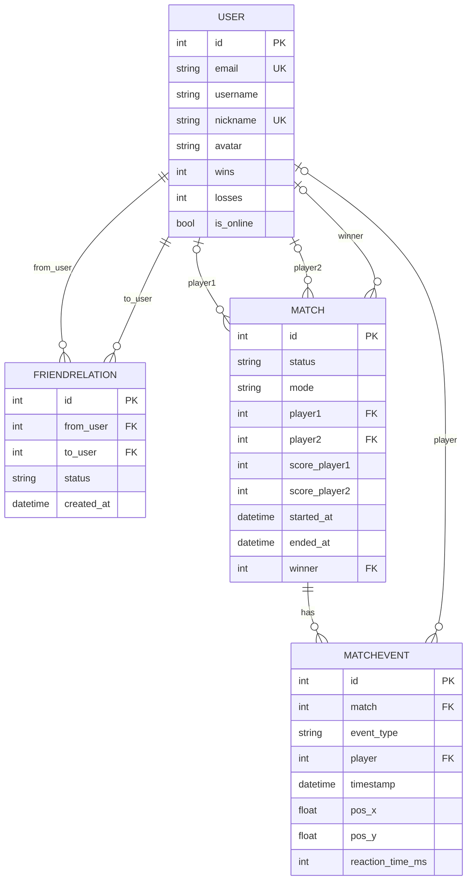

# Database Schema — Transcend (ft_transcendence)

**Database:** PostgreSQL 15 · **ORM:** Django ORM

## ER Diagram

> Solid line (`||`) = mandatory relation, `on_delete=CASCADE`, FK cannot be `null`.
> `|o` on the User side = optional relation, `on_delete=SET_NULL`, field is `null=True` (`player1`, `player2`, `winner`, `MatchEvent.player`).

Legend: 🔗 = foreign key field referencing another table.

---

## User (`users_user`)

Extends `AbstractUser`.

| Field | Type | Parameters |
|---|---|---|
| id | AutoField | PK |
| email | EmailField | unique=True, `USERNAME_FIELD` |
| username | CharField | = email, set in `UserManager.create_user()` |
| nickname | CharField | max_length=50, unique=True |
| avatar | ImageField | upload_to='avatars/', blank=True |
| wins | IntegerField | default=0 |
| losses | IntegerField | default=0 |
| is_online | BooleanField | default=False |

*Referenced by: `FriendRelation.from_user/to_user`, `Match.player1/player2/winner`, `MatchEvent.player`.*

---

## FriendRelation (`users_friendrelation`)

| Field | Type | Parameters |
|---|---|---|
| id | AutoField | PK |
| 🔗 from_user | ForeignKey → **User** | on_delete=CASCADE, related_name='sent_invites' |
| 🔗 to_user | ForeignKey → **User** | on_delete=CASCADE, related_name='received_invites' |
| status | CharField | max_length=10, default='pending' |
| created_at | DateTimeField | auto_now_add=True |

---

## Match (`game_match`)

| Field | Type | Parameters |
|---|---|---|
| id | AutoField | PK |
| status | CharField (TextChoices) | pending / active / finished |
| mode | CharField (TextChoices) | local / remote / ai |
| 🔗 player1 | ForeignKey → **User** | on_delete=SET_NULL, null=True, related_name='matches_as_player1' |
| 🔗 player2 | ForeignKey → **User** | on_delete=SET_NULL, null=True, related_name='matches_as_player2' |
| score_player1 | IntegerField | default=0 |
| score_player2 | IntegerField | default=0 |
| started_at | DateTimeField | auto_now_add=True |
| ended_at | DateTimeField | null=True, blank=True |
| 🔗 winner | ForeignKey → **User** | on_delete=SET_NULL, null=True, blank=True, related_name='won_matches' |

*Referenced by: `MatchEvent.match`.*

---

## MatchEvent (`game_matchevent`)

| Field | Type | Parameters |
|---|---|---|
| id | AutoField | PK |
| 🔗 match | ForeignKey → **Match** | on_delete=CASCADE |
| event_type | CharField (TextChoices) | hit / miss / goal |
| 🔗 player | ForeignKey → **User** | on_delete=SET_NULL, null=True, related_name='match_events' |
| timestamp | DateTimeField | auto_now_add=True |
| pos_x | FloatField | null=True |
| pos_y | FloatField | null=True |
| reaction_time_ms | IntegerField | null=True |

---

## Relations

| Relation | on_delete | Why |
|---|---|---|
| `FriendRelation.from_user/to_user` → `User` | CASCADE | A friendship record without one of the two participants is meaningless — it's deleted along with the user |
| `Match.player1/player2/winner` → `User` | SET_NULL | A match is a historical fact and should remain in the other player's history/stats even if the opponent deletes their account |
| `MatchEvent.match` → `Match` | CASCADE | An event (hit/miss/goal) is a component of a specific match and has no meaning outside it |
| `MatchEvent.player` → `User` | SET_NULL | An event is part of the match's analytics/timeline (heatmap, rally timeline) and should persist even after the player is deleted |

**General pattern:** CASCADE — where an entity is meaningless without the other party (a relationship between two people). SET_NULL — where the record is self-contained and should outlive the deletion of a participant (a match, a match event).